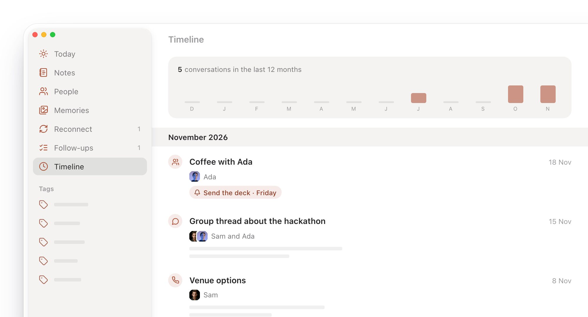
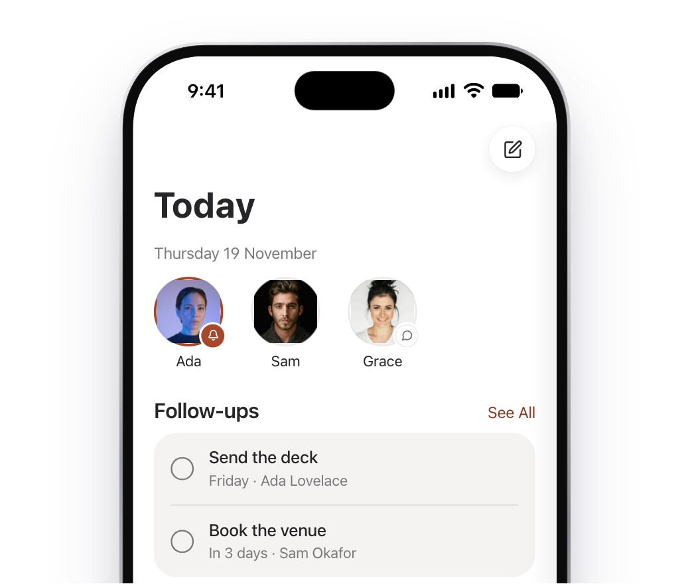
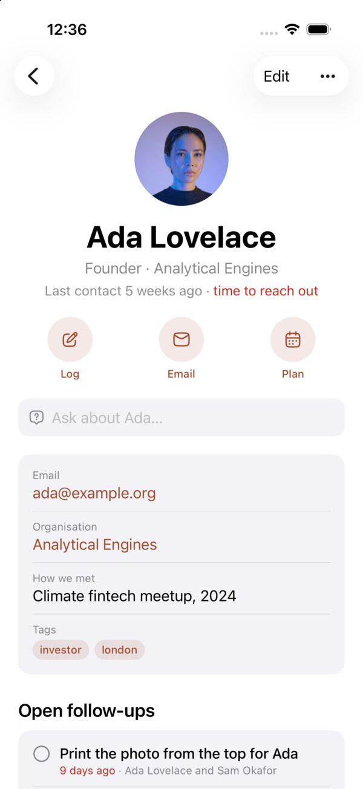
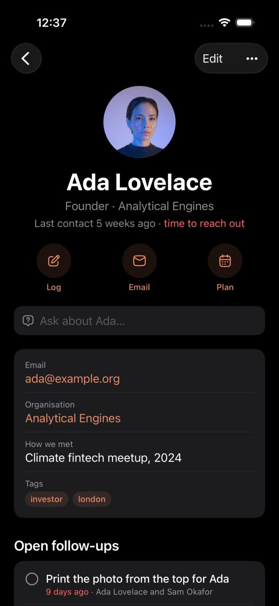
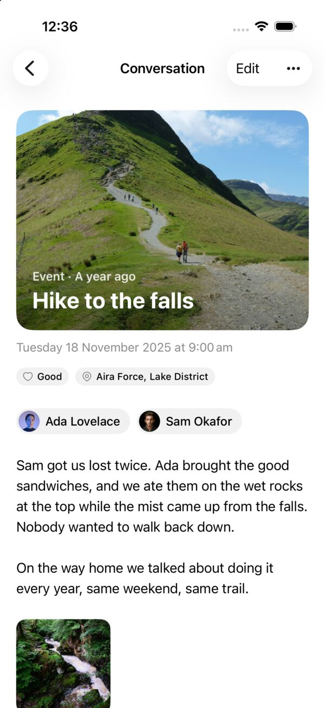
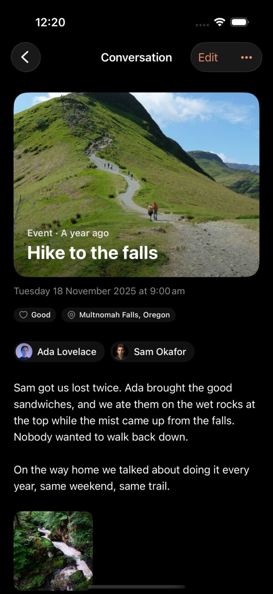
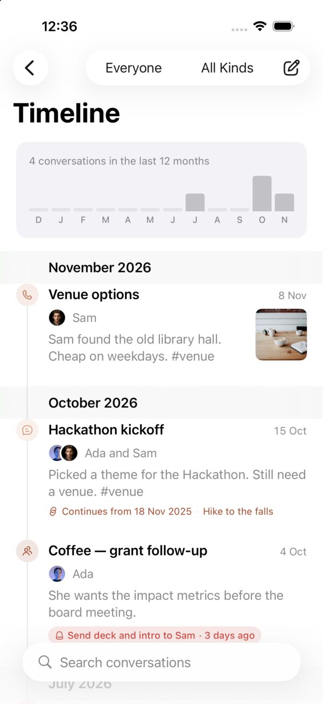
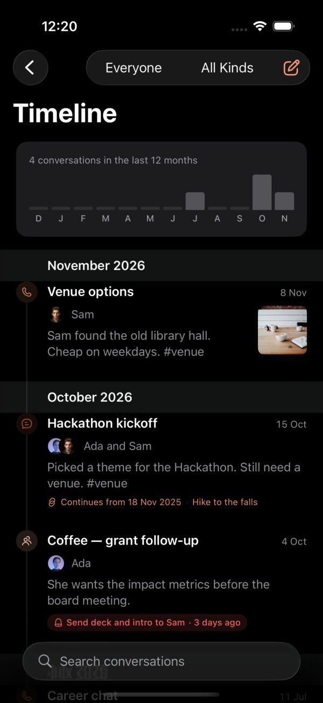
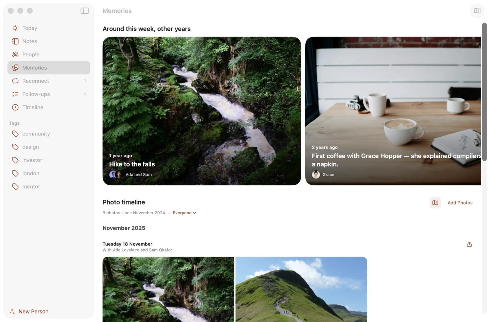
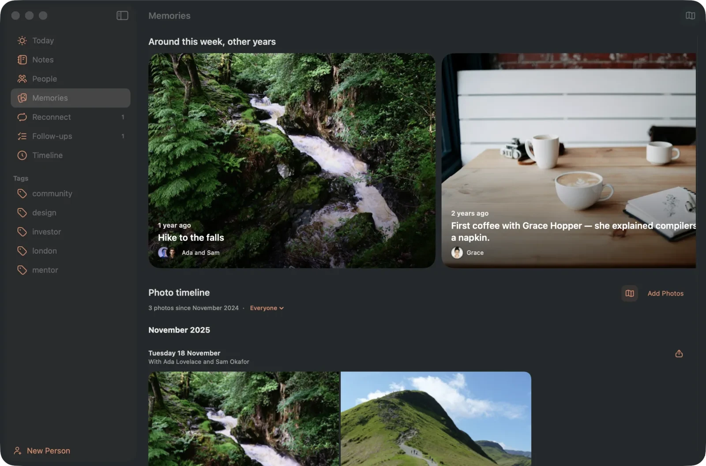

<link rel="stylesheet" href="/assets/css/enishi.css?v=1">
<link rel="stylesheet" href="/assets/js/enishi/stages.css?v=1">

  
  
For iPhone, iPad, Mac and Apple Watch

  <h1>Enishi</h1>
  
A private notebook about the people in your life: what you talked about, what you promised and the moments you shared, kept as plain files that are yours.

  


    

    <a class="en-store" href="{{ site.data.enishi.app_store_url }}" aria-label="Download Enishi on the App Store"><small>Download on the</small><strong>App Store</strong></a>

    <small>Coming to the</small><strong>App Store</strong>


    <a class="en-button" href="{{ site.data.enishi.mac_download_url }}">Download for Mac</a>

  


  
Mac: version {{ page.version }} · For macOS {{ site.data.enishi.minimum_macos }} or later · <a href="{{ site.data.enishi.mac_releases_url }}">Release notes</a>


  
The Mac download isn’t ready yet · For macOS {{ site.data.enishi.minimum_macos }} or later



  

<section class="en-stack" id="features">
  

    <h2>Log it in a sentence</h2>
    
Write what happened the way you’d say it: “coffee with Ada yesterday, follow up Friday: send the deck”. Enishi works out who it was with, when it was and what you said you’d do.

  

  <ul class="en-points">
    <li>Type it or say it, on iPhone, iPad or Apple Watch.</li>
    <li>On the Mac, the quick log opens from the menu bar with ⌃⌥M, over whatever you’re doing.</li>
    <li>Add a note, a place, photos or a follow-up when there’s more to say.</li>
    <li>Every conversation joins the timeline, and ones that continue each other become a thread.</li>
  </ul>
</section>

<section class="en-row">
  

    <h2>Who today is about</h2>
    
Today starts with faces: the people with something due, a birthday or a meeting. Tap one to see everything you know about them.

    <ul class="en-points">
      <li>Follow-ups that are due, and birthdays coming up.</li>
      <li>People you haven’t spoken to in a while.</li>
      <li>Meetings from your calendar, each with a short brief on who you’re about to see.</li>
      <li>A daily page for whatever else happened.</li>
    </ul>
  

  

    

      
    

  

</section>

<section class="en-shots">
  

    <h2>Everyone has a page</h2>
    
What you talked about, what you promised, the dates that matter to them and the photos you’re in together, on one page for each person.

  

  

    <figure class="en-shot">
      
      
    </figure>
    <figure class="en-shot">
      
      
    </figure>
    <figure class="en-shot">
      
      
    </figure>
  

</section>

  <section class="en-copy">
    <h2>Reconnect</h2>
    
Give someone a gentle rhythm, like keep in touch every month, and Enishi lets you know when it’s been a while. Mark that you touched base and the clock starts again.

  </section>
  <section class="en-copy">
    <h2>Follow-ups</h2>
    
Every “I’ll send it Friday” becomes a follow-up, with its person and its day. They’re kept in an Enishi list in Reminders too, and ticking one off there ticks it off here.

  </section>

<section class="en-wide">
  

    <h2>Memories</h2>
    
The same week in other years, with your photos as the heroes, and a photo timeline and map of where you’ve been and who with. Photos you choose are copied into your notebook; your library isn’t changed.

  

  

    
    
  

</section>

<section class="en-stack">
  

    <h2>Your notebook is a folder</h2>
    
Every person, conversation and page is a plain Markdown file, with photos beside it. Keep the folder on your device, in iCloud Drive so your iPhone, iPad and Mac show the same notebook, or in any folder on your Mac.

  

  <ul class="en-points">
    <li>Open, copy, back up or edit the files with any app, at any time.</li>
    <li>Open a notebook someone has shared with you through iCloud Drive, like a family notebook.</li>
    <li>Bring in what you already have from Contacts, Day One, Obsidian, Notion and LinkedIn.</li>
    <li>Deleted people, conversations and pages wait in Recently Deleted for 30 days.</li>
  </ul>
</section>

<section class="en-group">
  

    <h2>Pages, and what you keep to yourself</h2>
  

  

    
<h3>Pages and a daily page</h3>
Write as you would in a journal. Mention people with @, link pages with [[double brackets]] and keep checklists.

    
<h3>Private people and locked pages</h3>
Enishi shows only the name until Face ID or Touch ID unlocks them, and leaves them out of Spotlight, widgets, Siri, notifications and anything an assistant can read.

    
<h3>Letters to the future</h3>
Write a page and seal it until a date. Before that day it can’t be read, searched or reached by an assistant.

  

</section>

<section class="en-group">
  
<h2>Also in Enishi</h2>

  

    
<h3>Ask your notebook</h3>
On devices with Apple Intelligence, Enishi summarises conversations and answers questions about your notebook, on your device.

    
<h3>A connector for assistants</h3>
On the Mac, a built-in connector (MCP) lets an assistant like Claude work with your notebook, if you turn it on. You choose whether it can only read or also make changes. Private people and locked pages are always withheld.

    
<h3>Business cards</h3>
Scan a card with the camera and a new person is filled in. The card is read on your device and the photo isn’t kept.

    
<h3>Spotlight, widgets, Siri and Shortcuts</h3>
Find people and pages from search, see follow-ups and birthdays on your Home Screen, and use Enishi’s actions in Siri and Shortcuts.

    
<h3>Postcards and books</h3>
Make a postcard from a memory, or a keepsake book as a PDF.

    
<h3>English and Japanese</h3>
Enishi is written in both, and follows the language your device uses.

    
<h3>Updates on the Mac</h3>
Enishi asks before it checks for updates on its own, and checking sends nothing about you or your notebook. Enishi installs only updates signed by Enishi.

    
<h3>Contacts</h3>
Add people from your address book, see when their details have changed, and add a link to Enishi on a contact’s card when you ask.

    
<h3>How it felt</h3>
Note how a conversation felt. If you turn it on, Enishi saves it to Apple Health as a State of Mind entry.

  

</section>

  <section>
    <h2>Private by design</h2>
    
No account, no analytics and no tracking, and nothing is sent to us. Enishi goes online only to sync through your own iCloud Drive if you keep your notebook there, to show maps, and on the Mac to check for updates, which it asks about first.

    
Summaries and answers are made on your device. The details are in the <a href="/enishi/privacy/">privacy policy</a>.

  </section>
  <section>
    <h2>Getting Enishi</h2>
    
Enishi for iPhone, iPad and Apple Watch is on the <a href="{{ site.data.enishi.app_store_url }}">App Store</a>.Enishi for iPhone, iPad and Apple Watch is coming to the App Store. Enishi for Mac is a <a href="{{ site.data.enishi.mac_download_url }}">direct download</a>, for macOS {{ site.data.enishi.minimum_macos }} or later.Enishi for Mac will be a direct download, for macOS {{ site.data.enishi.minimum_macos }} or later.

    
Questions or ideas? Email <a href="mailto:{{ site.data.enishi.support_email }}">{{ site.data.enishi.support_email }}</a>.

  </section>

The scenes on this page are drawn from Enishi’s interface. The people in them are made up and their photos are stock. Enishi is made by Bakari Mustafa.

<nav class="en-foot" aria-label="Enishi pages">
  <a href="/enishi/" aria-current="page">Enishi</a>
  <a href="/enishi/privacy/">Privacy</a>
  <a href="/legal/privacy/">Website privacy policy</a>
</nav>

