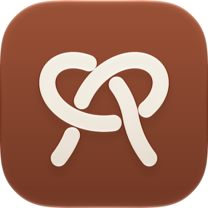

<link rel="stylesheet" href="/assets/css/enishi.css?v=1">

  
<a href="/enishi/">Enishi</a> › Privacy

  <h1>Privacy policy</h1>
  
Enishi keeps private notes about the people in your life: who they are, what you talked about, what you promised, and the moments you shared. It is built so that those notes stay yours.

  
Last updated: {{ site.data.enishi.privacy_updated }}

## What Enishi collects {#collects}

Nothing. Enishi has no account, no sign-in, no analytics, no advertising and no tracking. We do not run servers that receive your notes, and we never sell or share them.

## Where your notes live {#where}

Your notebook is a folder of plain Markdown files: one file per person, conversation and page, with photos and recordings beside them. You choose where the folder is:

- **On your device**, inside Enishi.
- **In iCloud Drive**, so your iPhone, iPad and Mac show the same notebook. iCloud is Apple's service, under Apple's terms, in your own Apple Account. We have no access to it.
- **In another folder you choose on your Mac.**

Because they are ordinary files, you can open, copy, back up or delete them with any app, at any time.

### Shared notebooks {#shared}

You can open a notebook that someone else has shared with you through iCloud Drive, such as a family notebook. Everyone it's shared with can read what's in it. Your own notebook is never shared unless you share its folder yourself.

## Private people and locked pages {#private}

You can mark a person private and lock a page. While they're locked, Enishi shows only their name and asks for Face ID, Touch ID or your passcode before showing more. Face ID and Touch ID are handled by Apple: Enishi only learns whether unlocking succeeded.

Private people and locked pages are always left out of Spotlight, widgets, Siri and Shortcuts, Handoff, notifications and anything an AI assistant can read (see below).

## Letters to the future {#letters}

A page you seal until a date can't be read, searched or reached by an assistant before that day.

## Permissions Enishi asks for {#permissions}

Each is optional, asked for only when you use the feature, and can be turned off in Settings at any time.

- **Contacts.** To add people from your address book, check your contacts for updated details, and, when you ask, add an Enishi link to a contact's card. On iPhone and iPad you can pick only the people you want to share.
- **Calendars.** To suggest who you met from your recent meetings, prepare a short brief before upcoming ones, and add meetings you plan to your calendar.
- **Reminders.** To keep your follow-ups in an "Enishi" list in Reminders and mark them done when you tick them there.
- **Photos.** If you turn on "On this day from Photos", Enishi shows photos you took on this date in past years and copies the ones you choose into your notebook. Nothing in your photo library is changed.
- **Camera.** To scan a business card and fill in a new person's details. The photo of the card is read on your device and not kept.
- **Microphone and speech recognition.** To let you say what happened instead of typing. What you say is turned into text on your device. If you choose to keep the recording with a conversation, it's saved in your notebook beside it.
- **Health.** If you turn it on, Enishi saves how a conversation felt to Apple Health as a State of Mind entry. Enishi doesn't read anything from Health.
- **Face ID or Touch ID.** To unlock private people and locked pages.
- **Notifications.** For follow-up and birthday reminders, scheduled on your device.

## On-device processing {#processing}

Enishi reads business cards and photos with Apple's on-device text and image recognition, and finds faces you've named in your own photos on your device. On devices with Apple Intelligence, summaries and answers to your questions use Apple's on-device language model. None of this sends your notes anywhere.

## Spotlight, widgets, Siri and Shortcuts {#system}

Enishi adds your people, conversations and pages to Spotlight on your device so you can find them from search, shows follow-ups and birthdays in widgets, and offers actions to Siri and Shortcuts. These stay on your device. Private people, locked pages and sealed letters are left out.

## AI assistants (Mac) {#assistants}

On the Mac you can let an AI assistant app you use, such as Claude, work with your notebook through Enishi's built-in connector (MCP). It's controlled in Enishi's Settings, where you can turn it off, decide whether assistants may only read or also make changes, and see a list of everything they've asked for.

When you connect an assistant, that app can read the parts of your notebook it asks for, and send them to its own service to answer you. That is between you and the assistant's provider, under their privacy policy. Enishi always withholds private people (their names, details and conversations), locked pages and sealed letters.

## When Enishi goes online {#online}

Enishi itself only connects to the internet:

- **To sync your notebook through iCloud Drive**, if you keep it there. This is Apple's service.
- **To check for updates on the Mac**, if you downloaded Enishi from our website. Enishi asks before it checks automatically, and you can always choose Enishi › Check for Updates… The check fetches a list of versions from GitHub, where Enishi's downloads are published. Like any web request, it reveals your IP address and Enishi's version to GitHub; it sends nothing about you or your notebook. Enishi installs only updates signed with Enishi's own key.
- **To show maps** of places, using Apple Maps under Apple's privacy policy.
- **To open links** you tap, in your browser.

## Imports and exports {#imports}

You can import people and notes from files you choose (Contacts cards, spreadsheets, Day One, Obsidian, Notion, LinkedIn) and export to files, PDFs, postcards and an archive. Enishi doesn't receive any of these files. Anything you export goes where you save or send it.

## Deleting your data {#deleting}

Deleted people, conversations and pages go to Recently Deleted for 30 days, then they're removed. You can delete your whole notebook by deleting its folder. Deleting Enishi removes a notebook kept inside the app; a notebook in iCloud Drive or another folder stays there until you delete it.

## Children {#children}

Enishi is not directed at children and does not knowingly collect information from anyone.

## Changes {#changes}

If this policy changes, we'll update the date at the top.

## Contact {#contact}

Questions about this policy or about Enishi: [{{ site.data.enishi.support_email }}](mailto:{{ site.data.enishi.support_email }})

<nav class="en-foot" aria-label="Enishi pages">
  <a href="/enishi/">Enishi</a>
  <a href="/enishi/privacy/" aria-current="page">Privacy</a>
  <a href="/legal/privacy/">Website privacy policy</a>
</nav>

