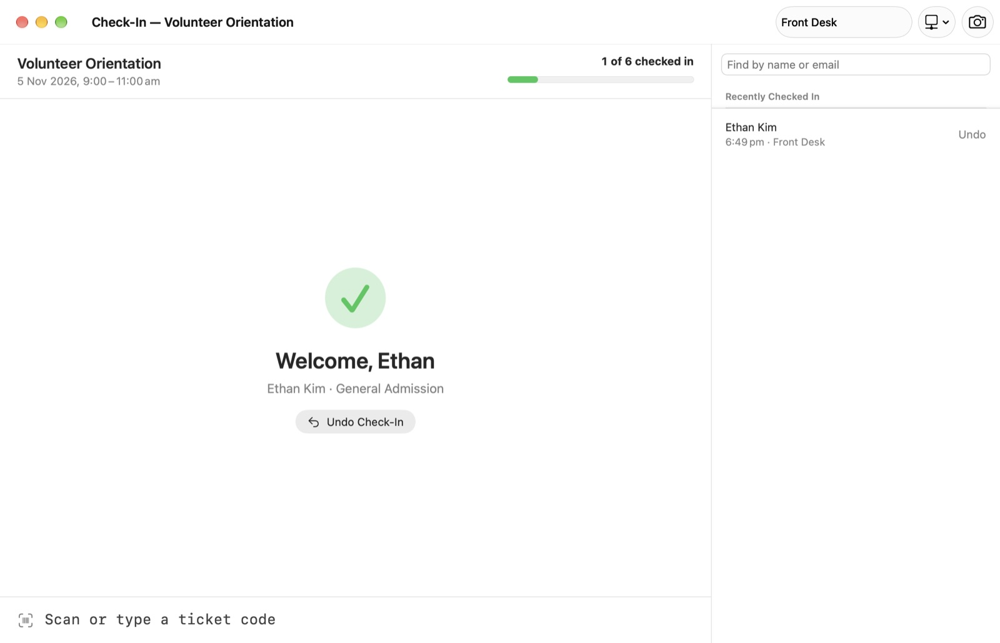
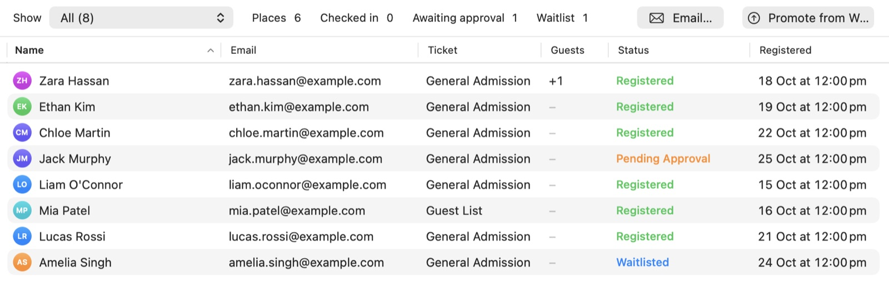
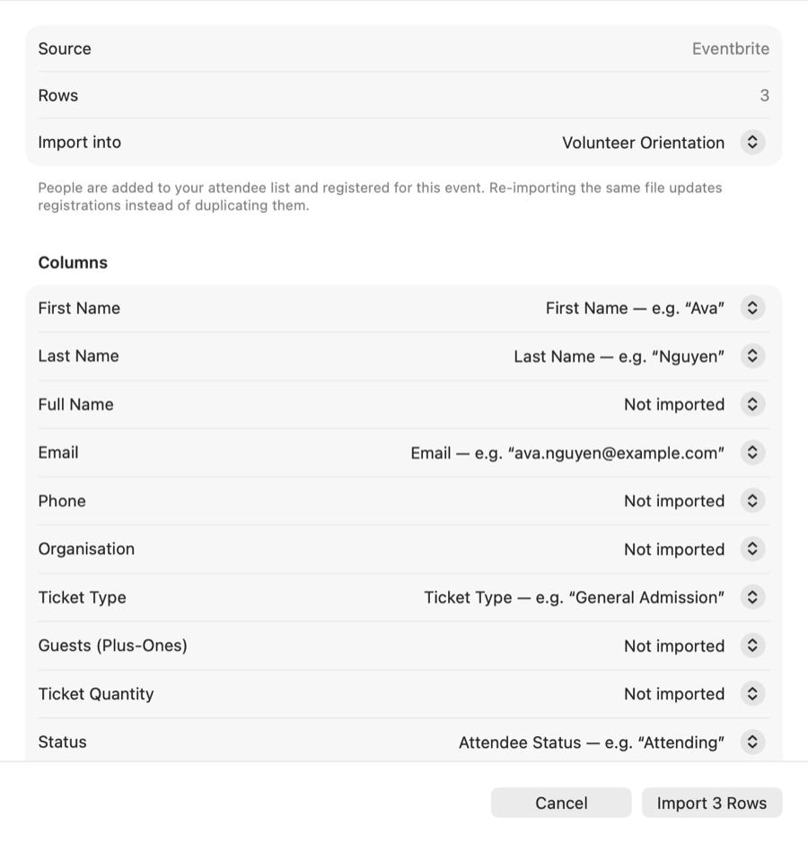
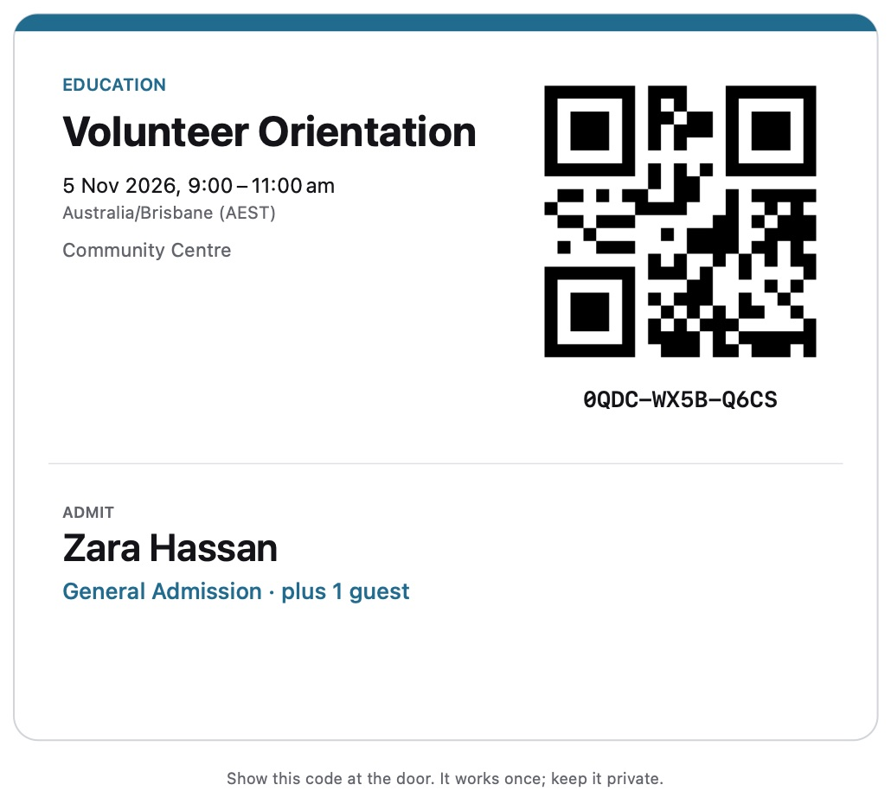
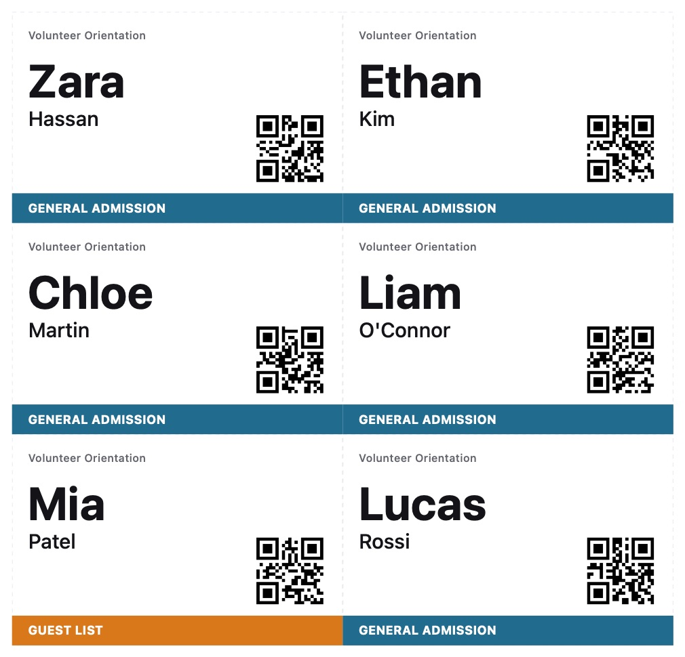
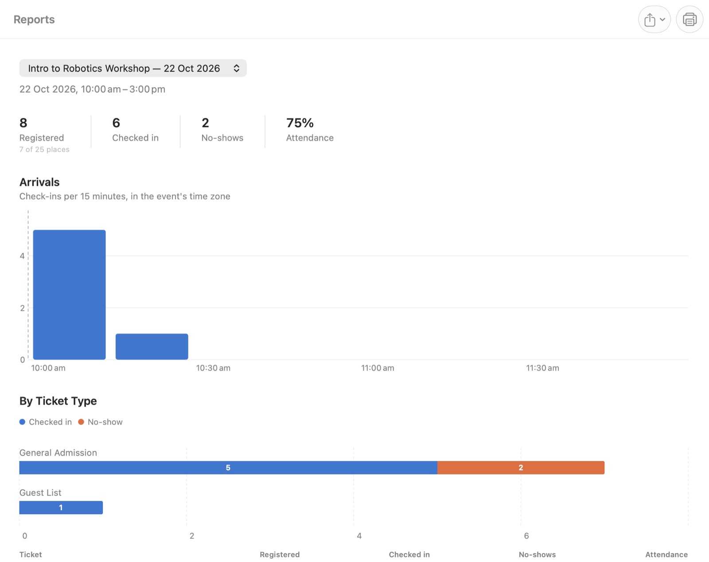
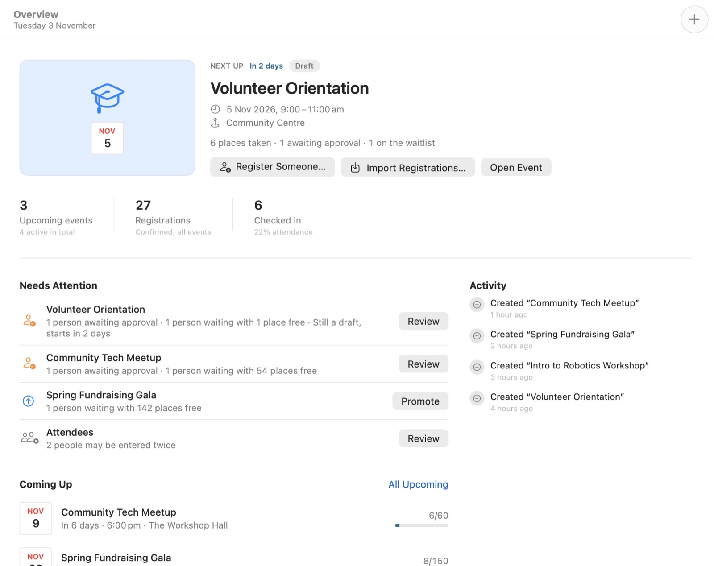

<link rel="stylesheet" href="/assets/js/gatherkit/stages.css">

  
  
For Mac

  <h1>GatherKit</h1>
  
Events, tickets and check-in for people who run events without an events team. Register people, print tickets and badges, and check everyone in at the door, even with no internet.

  

    <a class="gk-button is-primary" href="https://github.com/realbakari/gatherkit-mac/releases/latest/download/GatherKit.zip">Download for Mac</a>
    <a class="gk-button" href="#features">See what it does</a>
  

  
Version 1.0 · Requires macOS 14 · <a href="https://github.com/realbakari/gatherkit-mac/releases">Release notes</a>

  

<section class="gk-stack" id="features">
  

    

      <h2>Everyone in one list</h2>
      
One list of people across all your events, and a registration table for each event. GatherKit keeps the count right as places fill, so an event never goes over capacity by accident.

    

    <ul class="gk-points">
      <li>Approvals, waitlists, plus-ones, ticket types and complimentary guest-list places.</li>
      <li>Promote from the waitlist when a place frees up.</li>
      <li>Spots the same person entered twice and merges them in one click.</li>
      <li>Times in the event’s own time zone, venues, cover images and templates to reuse.</li>
    </ul>
  

  

    
  

</section>

<section class="gk-row is-flipped">
  

    <h2>Bring the list you already have</h2>
    
Already sell tickets somewhere else? Import the export from Eventbrite, Humanitix, Luma, Tito or Google Forms. GatherKit recognises the file, matches its columns and shows exactly what will change before anything does.

    <ul class="gk-points">
      <li>Import the same file again and registrations update instead of doubling.</li>
      <li>Any spreadsheet with names and emails works too.</li>
      <li>Or connect your Luma, Humanitix, Tito or Eventbrite account with your own key. Sync only downloads.</li>
    </ul>
  

  

    
  

</section>

<section class="gk-print">
  

    <h2>Ready for the door</h2>
    
Every confirmed guest gets a ticket with a QR code. The code is twelve random characters and holds no personal details, so a forwarded ticket gives nothing away.

  

  

    

      
    

    

      
    

  

  

    

      <h3>Printed at true size</h3>
      
Tickets, and sheets of name badges on A4 or US Letter paper.

    

    

      <h3>Label printers</h3>
      
Name badges on Brother QL and DYMO label rolls.

    

    

      <h3>A paper guest list</h3>
      
Everyone expected on paper, for a door with no Mac.

    

  

</section>

<section class="gk-row">
  

    <h2>See who came</h2>
    
After the event, the report is waiting: registrations, check-ins, no-shows and the attendance rate, arrivals in 15-minute steps, and attendance by ticket type.

    <ul class="gk-points">
      <li>Export it as a PDF for the committee.</li>
      <li>Or as a CSV of numbers only, with no one’s personal details in it.</li>
    </ul>
  

  

    
  

</section>

<section class="gk-row is-flipped">
  

    <h2>Know what needs doing</h2>
    
Overview opens on your next event and lists what needs you: people awaiting approval, waitlists with free places, events still in draft and people who may be in the list twice.

  

  

    
  

</section>

  
<h3>Works offline</h3>
Check-in needs no internet. Nor does anything else, except syncing with a ticketing platform.

  
<h3>Several Macs at the door</h3>
Run a station on each Mac, then merge their check-ins afterwards. No one is counted twice.

  
<h3>Scan any way</h3>
A USB or Bluetooth barcode scanner, the Mac’s camera, a typed code or a name search.

  
<h3>Email your guests</h3>
Drafts to attendee groups open in Mail, in batches, with everyone in BCC.

  
<h3>Backups</h3>
Back up and restore the whole library, and export calendar files for any event.

  
<h3>Try it first</h3>
Help › Explore the Sample Library opens sample events to play with. Your own library is untouched.

  <section class="gk-panel">
    <h2>Private by design</h2>
    
No account, no server, no analytics and no advertising. Everything you enter stays on your Mac. When an event is over, GatherKit can anonymise the people who came and keep only the numbers.

  </section>
  <section class="gk-panel">
    <h2>Help</h2>
    
The app has a built-in guide: press ⌘?. For anything else, email <a href="mailto:bakari@bakarimustafa.com">bakari@bakarimustafa.com</a> or <a href="https://github.com/realbakari/gatherkit-mac/issues">open an issue</a>.

  </section>

Screenshots show GatherKit’s sample library; the people in them aren’t real. GatherKit is made by Bakari Mustafa.

