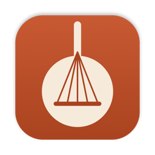
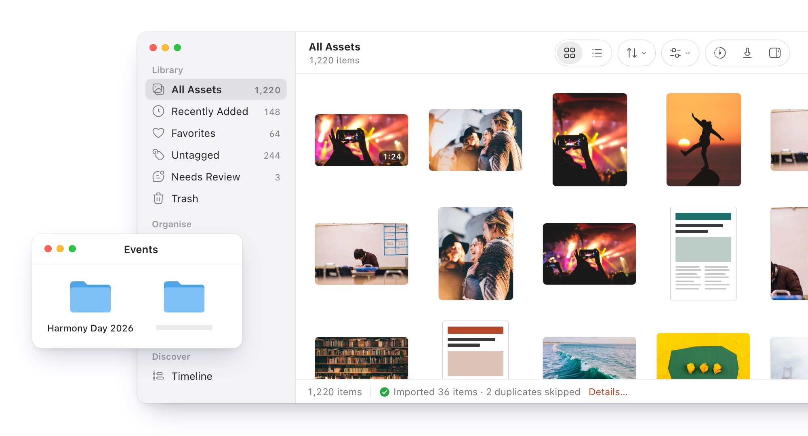
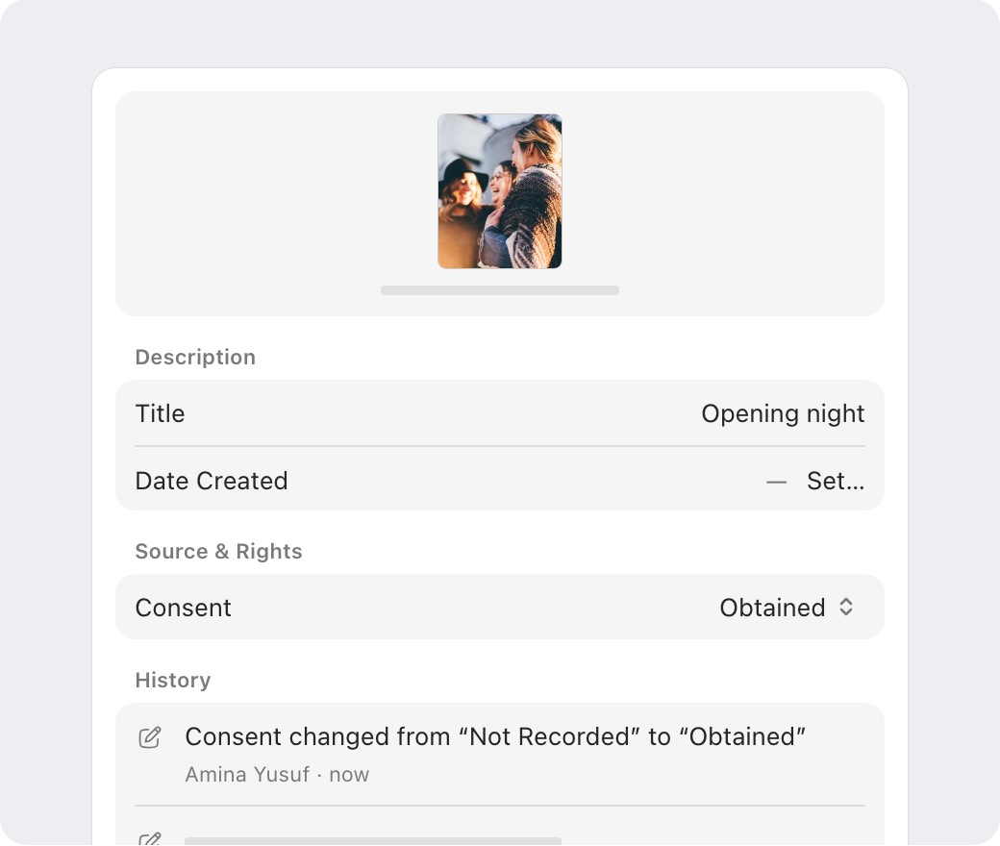
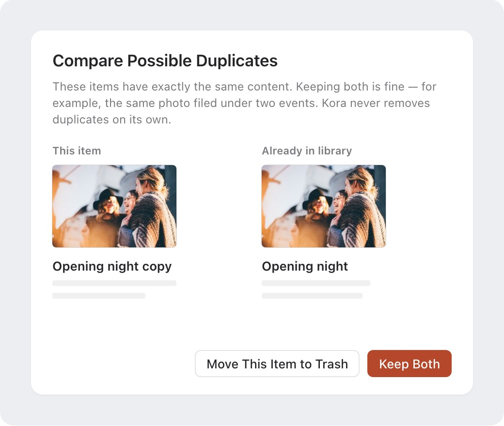

<link rel="stylesheet" href="/assets/js/kora/stages.css">

  
  
For Mac · In development

  <h1>Kora</h1>
  
A home for your community’s photos, videos, recordings, flyers and newsletters. Bring years of scattered files together, describe them as you go, find anything again, and turn what you’ve kept into stories, exhibitions and reports.

  


    <a class="kp-button" href="https://github.com/realbakari/kora-releases/releases/latest">Download for Mac</a>
    <a class="kp-textlink" href="#features">See what it does</a>

    <a class="kp-button" href="#features">See what it does</a>

  


  
Version {{ page.version }} · For macOS 15 or later · <a href="https://github.com/realbakari/kora-releases/releases">Release notes</a>


  
Not yet available to download · For macOS 15 or later



  

<section class="kp-stack" id="features">
  

    <h2>Bring it all together</h2>
    
Drag in files or whole folders from a computer, an old drive or a USB stick. Kora takes photos, videos, audio, PDFs, documents, presentations and spreadsheets, makes a preview of each, and reads the details and the words already in the files.

  

  <ul class="kp-points">
    <li>Your originals stay where they are and are never changed. Kora can also keep its own copy, for a drive that has to go back to its owner.</li>
    <li>An import that’s interrupted picks up where it stopped.</li>
    <li>Anything Kora can’t read is listed with what went wrong and what to do. Nothing is skipped silently.</li>
    <li>Duplicates are recognised by their content, whatever they’re called.</li>
  </ul>
</section>

<section class="kp-row">
  

    <h2>Describe as you go</h2>
    
Select anything and its details sit beside it: title, description, date, place, community, creator, source, copyright, licence, consent and notes. A date nobody knows stays blank. Kora never guesses one.

    <ul class="kp-points">
      <li>Record consent for every item: Not Recorded, Not Required, Pending, Obtained, Refused or Withdrawn.</li>
      <li>Every change goes into the item’s history: what changed, who changed it and when.</li>
      <li>Tags are suggested as you type, and “Youth” and “youth” stay one tag.</li>
      <li>Edit many items at once. Only the fields you touch change, and ⌘Z undoes the lot.</li>
    </ul>
  

  

    

      
    

  

</section>

<section class="kp-row is-flipped">
  

    <h2>Duplicates are your call</h2>
    
Kora leaves out a file it already has and says so. If you’d rather see for yourself, it brings the copy in flagged for review and shows the two side by side. Keep both, or move one to the Trash. Kora never removes one on its own.

    <ul class="kp-points">
      <li>Needs Review gathers possible duplicates, missing originals and files that couldn’t be read.</li>
      <li>Work through it with single keys: F to favourite, R to mark as reviewed, T to add a tag.</li>
      <li>Moved a file? Point Kora to it, and Kora checks by its content that it’s the same file before reconnecting it.</li>
    </ul>
  

  

    

      
    

  

</section>

  <section class="kp-copy">
    <h2>Find anything</h2>
    
Search looks through titles, descriptions and tags, the people, events and organisations linked to each item, the words in documents, and the text Kora reads in photos, flyers and scanned pages. The reading happens on your Mac.

    
Save a search and it stays in the sidebar, up to date as the library grows.

  </section>
  <section class="kp-copy">
    <h2>Who, when and where</h2>
    
Give events, people and organisations a page each, link them to items and to one another, and see everything that belongs to them. Kora never identifies anyone or links them by itself.

    
The timeline tells your organisation’s story year by year: milestones you add, figures counted from the library, and suggestions drawn from dated events and collections that wait for you to accept them.

  </section>

<section class="kp-make">
  

    <h2>Share what you’ve kept</h2>
    
Turn the archive into something to read, to show and to report on. Before anything leaves the library, Kora tells you how many items have no consent recorded, or consent pending or refused, and asks you to confirm.

  

  

    
<h3>Stories</h3>
Photos, recordings, quotes and documents in order, in your own words, with captions, credits and sources. Export to PDF, Word, a web page, Markdown or plain text.

    
<h3>Exhibitions</h3>
Sections of items laid out as a grid, a feature or a timeline, in your colour and with your logo. Present them full screen, or export a web page that works offline.

    
<h3>Annual reports</h3>
A year’s figures counted from the library, each statement linked to the records it comes from, with your own introduction and notes. Export to PDF or Word.

  

</section>

<section class="kp-more">

<h2>Also in Kora</h2>

  
<h3>Collections and tags</h3>
Put an item in every collection it belongs to, gather collections into folders, and drag items onto them from the grid. Rename one tag to another and they merge.

  
<h3>Exports</h3>
Exact copies of the originals, each checked against its fingerprint, or previews, or details only, with a spreadsheet. GPS locations are left out unless you include them.

  
<h3>An optional assistant</h3>
Off until you turn it on, and it runs only on your Mac. It suggests descriptions, tags, summaries and collections, and understands searches typed as sentences. Nothing changes until you accept. Some suggestions need Apple Intelligence.

  
<h3>iCloud sync, if you want it</h3>
Turn it on for a library and its details and previews sync between your own Macs through your iCloud account. Originals stay on the Mac that has them.

  
<h3>Spotlight, if you want it</h3>
Find items, collections, events, stories and exhibitions from Spotlight. People’s names, notes and contact details are never added.

  
<h3>Updates</h3>
Kora asks before it checks for updates on its own, and checking sends nothing about you or your library. Kora installs only updates signed by Kora.

  
<h3>Filters</h3>
Narrow any view by type, consent, where the original is kept, or items with no date.

  
<h3>Quick Look and keys</h3>
Space to preview, Return to open, and ⌘K opens the command palette.

  
<h3>A Trash that keeps originals</h3>
Removed items wait in Kora’s Trash. Emptying it never deletes your original files.

</section>

  <section>
    <h2>Private by design</h2>
    
No account and no analytics. Kora connects to the internet only to sync with your own iCloud, if you turn that on, and to check for updates, which it asks about first.

    
Details and previews are encrypted on your Mac before they’re sent. With Advanced Data Protection turned on, only your devices can read them. The assistant never sends anything off your Mac, and Kora doesn’t recognise faces or name the people in your photos.

  </section>
  <section>
    <h2>What’s next</h2>
    
Kora is in development. Next come sharing a library with other people, so more than one person can look after the same archive, and an app for iPhone and iPad.

    
Questions or ideas? Email <a href="mailto:bakari@bakarimustafa.com">bakari@bakarimustafa.com</a>.

  </section>

The scenes on this page are drawn from Kora’s interface, with the Hugeicons icons Kora uses. The photos in them are from Unsplash, and the names are made up. Kora is made by Bakari Mustafa.

