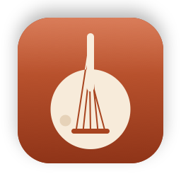
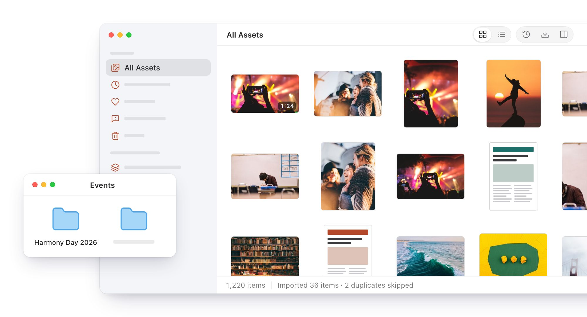
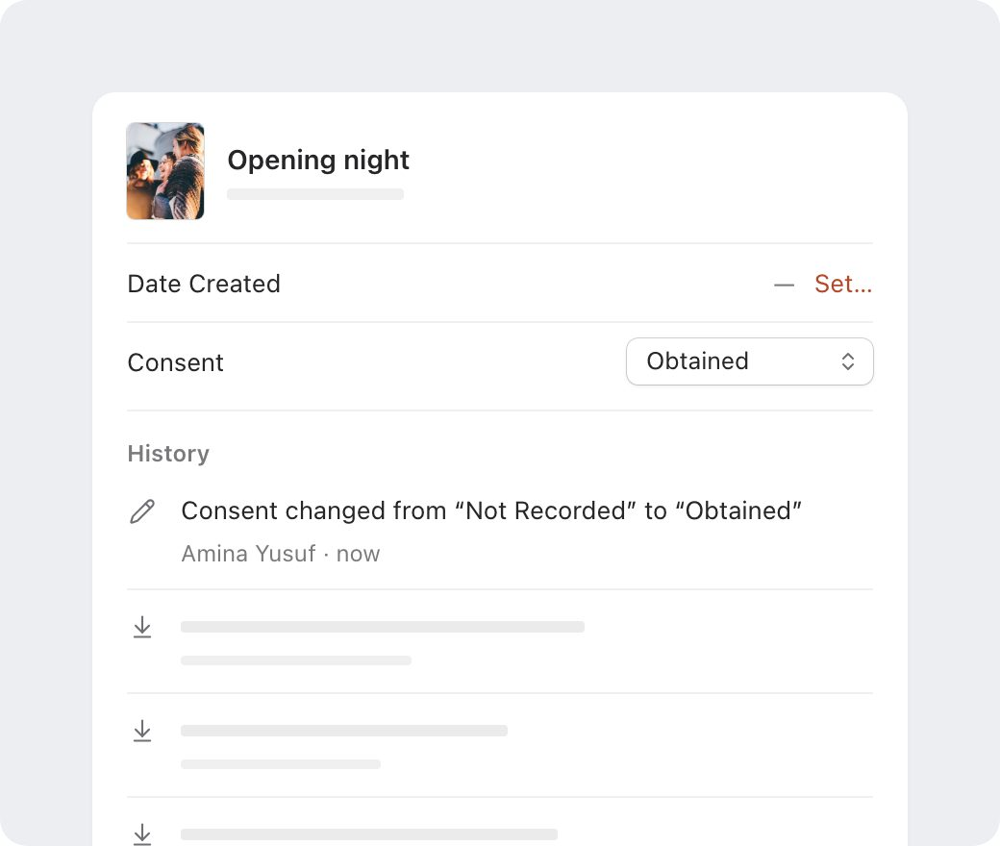
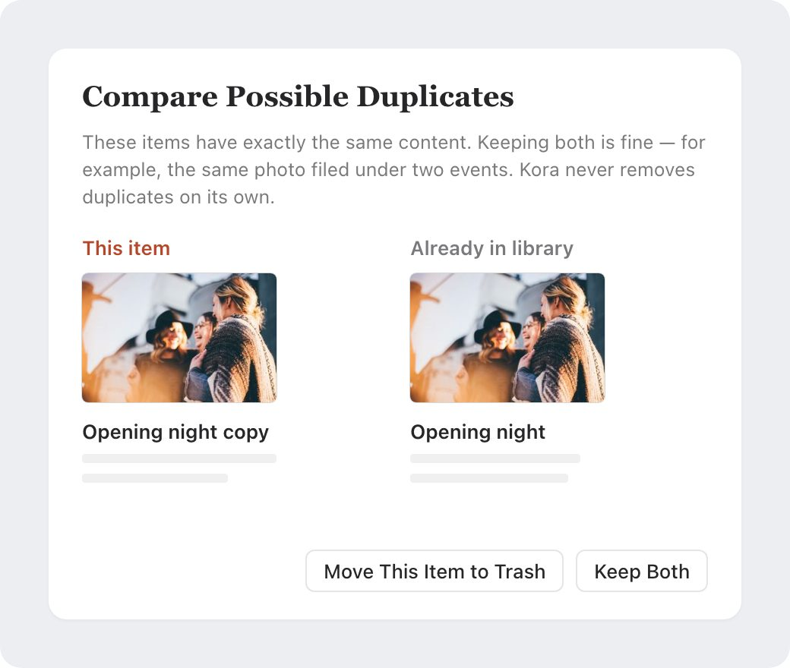

<link rel="stylesheet" href="/assets/js/kora/stages.css">

  
  
For Mac · In development

  <h1>Kora</h1>
  
A home for your community’s photos, videos, recordings, flyers and newsletters. Bring years of scattered files together, describe them as you go, and look after them for the long run. Everything stays on your Mac.

  

    <a class="kp-button is-primary" href="#features">See what it does</a>
  

  
Not yet available to download · For macOS 15 or later

  

<section class="kp-stack" id="features">
  

    <h2>Bring it all together</h2>
    
Drag in files or whole folders from a computer, an old drive or a USB stick. Kora takes photos, videos, audio, PDFs, documents, presentations and spreadsheets, makes a preview of each and reads the details already in the files.

  

  <ul class="kp-points">
    <li>Your originals stay where they are and are never changed. Kora can also keep its own copy, for a drive that has to go back to its owner.</li>
    <li>An import that’s interrupted picks up where it stopped.</li>
    <li>Anything Kora can’t read is listed with what went wrong. Nothing is skipped silently.</li>
    <li>Duplicates are recognised by their content, whatever they’re called.</li>
  </ul>
</section>

<section class="kp-row">
  

    <h2>Describe as you go</h2>
    
Select anything and its details sit beside it: title, description, date, place, community, creator, source, copyright, licence and notes. A date nobody knows stays blank. Kora never guesses one.

    <ul class="kp-points">
      <li>Record consent for every item: Not Recorded, Not Required, Pending, Obtained, Refused or Withdrawn.</li>
      <li>Every change goes into the item’s history: what changed, who changed it and when.</li>
      <li>Tags are suggested as you type, and “Youth” and “youth” stay one tag.</li>
      <li>Edit many items at once. Only the fields you touch change, and ⌘Z undoes the lot.</li>
    </ul>
  

  

    

      
    

  

</section>

<section class="kp-row is-flipped">
  

    <h2>Duplicates are your call</h2>
    
Kora leaves out a file it already has and says so. If you’d rather see for yourself, it brings the copy in flagged for review and shows the two side by side. Keep both, or move one to the Trash. Kora never removes one on its own.

    <ul class="kp-points">
      <li>Needs Review gathers possible duplicates, missing originals and files that couldn’t be read.</li>
      <li>Work through it with single keys: F to favourite, R to mark as reviewed, T to add a tag.</li>
      <li>Moved a file? Point Kora to it, and Kora checks by its content that it’s the same file before reconnecting it.</li>
    </ul>
  

  

    

      
    

  

</section>

  
<h3>Collections</h3>
Put an item in every collection it belongs to, gather collections into folders, and drag items onto them from the grid.

  
<h3>Tags</h3>
See every tag with how many items carry it. Rename one to another and they merge.

  
<h3>Filters</h3>
Narrow any view by type, consent, where the original is kept, or items with no date.

  
<h3>Grid or list</h3>
Thumbnails from small to large, with or without titles, or a list you can sort.

  
<h3>Quick Look and keys</h3>
Space to preview, Return to open, and ⌘K opens the command palette.

  
<h3>A Trash that keeps originals</h3>
Removed items wait in Kora’s Trash. Emptying it never deletes your original files.

  <section class="kp-panel">
    <h2>Private by design</h2>
    
No account, no server, no analytics. Kora doesn’t connect to the internet at all, so your files can’t go anywhere. It doesn’t recognise faces or name the people in your photos.

  </section>
  <section class="kp-panel">
    <h2>What’s next</h2>
    
Kora is in development. Next come search inside documents and scanned flyers, events, people and organisations, and a timeline; after that, stories and exhibitions to share what you’ve kept. Any AI features will be optional and off until you turn them on, and every suggestion will be yours to accept or reject.

    
Questions or ideas? Email <a href="mailto:bakari@bakarimustafa.com">bakari@bakarimustafa.com</a>.

  </section>

The scenes on this page are drawn from Kora’s interface. The photos in them are from Unsplash, and the names are made up. Kora is made by Bakari Mustafa.

