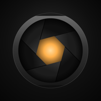
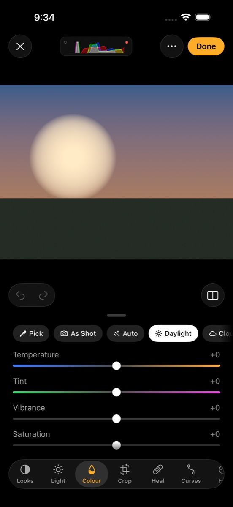
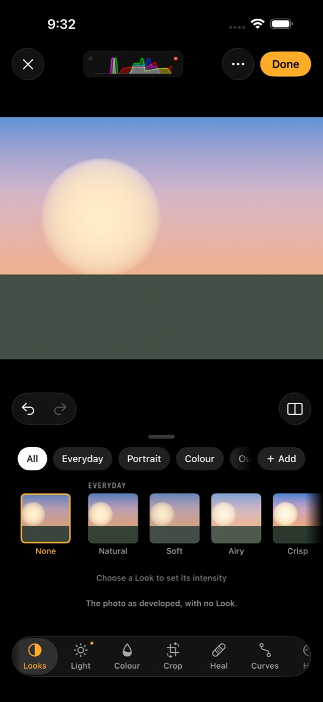
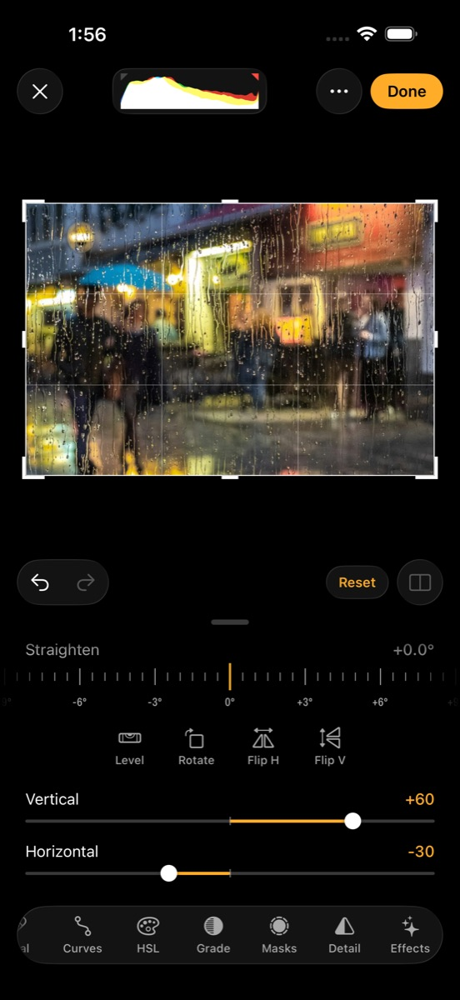

<link rel="stylesheet" href="/assets/css/lumen.css?v=2">

<section class="lu-stage">
  

    
    
Lumen for iPhone · Coming soon · On the App Store

    <h1>Shoot. Develop. Create.</h1>
    
A manual camera, a RAW developer and a photo editor in one app, with 48 original Looks you can see in the viewfinder before you shoot.

    

      
      
      
      <a class="lu-badge-soon lu-store-link" href="{{ site.data.lumen.app_store_url }}" aria-label="Download Lumen on the App Store"><small>Download on the</small><strong>App Store</strong></a>
      
      <small>Coming soon to the</small><strong>App Store</strong>
      
    

    
iPhone · iOS {{ site.data.lumen.minimum_ios }} or later

  

  

    
    
    
  

</section>

<ul class="lu-facts">
  <li><strong>No account</strong>Open it and shoot.</li>
  <li><strong>No tracking</strong>No analytics, no ads.</li>
  <li><strong>Offline</strong>Makes no network requests.</li>
  <li><strong>Apple Photos</strong>Your library, no import.</li>
</ul>

<section class="lu-section" id="camera">
  

    
Camera

    <h2>Every setting, yours to set.</h2>
    
Fix the shutter and Lumen finds the ISO. Fix the ISO and it finds the shutter. Fix both and you're in full manual. There's no mode dial to remember, and Lumen only shows what your iPhone's lenses can really do.

  

  

    
<h3>RAW your way</h3>
ProRAW or Bayer RAW, on its own or paired with HEIF or JPEG.

    
<h3>Spot and grey card</h3>
Drag the meter anywhere in the frame. Tap a grey card for exact white balance.

    
<h3>Size and frame</h3>
12, 24 or 48 MP, framed at 4:3, 3:2, 16:9 or 1:1, and undoable later.

    
<h3>Brackets to HDR</h3>
Shoot a bracket and Lumen aligns and merges it into one editable HDR photo.

    
<h3>Viewfinder aids</h3>
Histogram, zebras, focus peaking, clipping, a level and grids.

    
<h3>Camera Control</h3>
Slide to set exposure, change the Look or its strength.

  

</section>

<section class="lu-row is-flipped">
  

    
Develop and edit

    <h2>Develop the RAW, not the JPEG.</h2>
    
Lumen develops RAW files with Apple's RAW decoder, so you edit everything the sensor recorded. By default it adds no sharpening and no local tone mapping, which keeps the photo looking natural.

    
Then the full editor: curves, eight-band HSL, colour grading, perspective, heal and clone, and masks for the sky, a person or the subject. Edits are saved in Photos and the original is never touched.

  

  <figure class="lu-shot">
    
  </figure>
</section>

<section class="lu-row">
  

    
Looks

    <h2>48 Looks, all original.</h2>
    
Each Look is a complete colour rendering with one strength slider. They're built so skin stays natural and bright colours roll off instead of clipping, and they stay editable after you shoot.

    <ul class="lu-families">
      <li><strong>Everyday</strong>Natural, Soft, Airy, Crisp, Lively</li>
      <li><strong>Portrait</strong>Portrait, Glow, Porcelain, Bronze, Editorial</li>
      <li><strong>Colour</strong>Warm, Cool, Golden, Dusk, Savour, Chrome, Pastel, Pop, Deep</li>
      <li><strong>Outdoor</strong>Terrain, Meadow, Coast, Alpine, Dune</li>
      <li><strong>Urban</strong>Asphalt, Signal, Transit, Neon</li>
      <li><strong>Analog</strong>Fade, Documentary, Linen, Ember, Postcard, Citrus</li>
      <li><strong>Cinema</strong>Copper, Steel, Night, Lantern, Velvet, Mirage</li>
      <li><strong>Mono</strong>Mono, Pearl, Slate, Umber, Chalk, Ink, Infra, Frost</li>
    </ul>
    
Make your own from any edit, or bring your own <code>.cube</code> LUTs.

  

  <figure class="lu-shot">
    
  </figure>
</section>

<section class="lu-section">
  

    
Video

    <h2>The same care, in motion.</h2>
    
4K or 1080p from 24 to 60 fps, with 120 and 240 fps in 1080p where your iPhone offers them. Bake the Look into the clip, or record clean and keep the Look for later.

  

  

    
<h3>ProRes Log</h3>
Apple Log in ProRes on iPhones that support it, or HEVC.

    
<h3>Waveform and false colour</h3>
Judge exposure properly, even in Log.

    
<h3>Pause and gain</h3>
Pause a take and resume it in the same file. Ride the audio gain mid-take.

    
<h3>Record to a drive</h3>
Plug in a USB-C drive and record straight to it.

    
<h3>Keeps rolling</h3>
If the drive fills or comes loose, recording carries on to the iPhone.

    
<h3>180° shutter</h3>
Shutter speed follows the frame rate on its own.

  

</section>

<section class="lu-section">
  

    
More

    <h2>Ready when you are.</h2>
  

  

    
<h3>Shoot from the Lock Screen</h3>
Put Lumen Camera in Control Centre, on the Lock Screen or on the Action button.

    
<h3>Siri and Shortcuts</h3>
"Open Lumen in video mode." "Shoot with Golden in Lumen."

    
<h3>Cull fast</h3>
Swipe up to pick, down to reject. Stars, labels, stacks and side-by-side compare.

    
<h3>HDR photos</h3>
Single shots on auto exposure keep their highlights bright on HDR screens.

    
<h3>Export anything</h3>
JPEG, HEIF, PNG, 16-bit TIFF or AVIF, with or without location.

    
<h3>Batch edits</h3>
Apply a Look to a whole shoot, or paste one photo's edit onto the rest.

  

</section>

  <section class="lu-panel">
    <h2>Private by design</h2>
    
Lumen collects nothing. There's no account, no analytics and no network access, so your photos never leave your iPhone unless you share them. Location is off until you turn it on. <a href="/lumen/privacy/">Privacy policy</a>

  </section>
  <section class="lu-panel">
    <h2>Help</h2>
    
Guides to the camera, the editor and Looks, the Lock Screen camera, Shortcuts and recording to a drive are in <a href="/lumen/support/">Lumen Support</a>. Or email <a href="mailto:{{ site.data.lumen.support_email }}">{{ site.data.lumen.support_email }}</a>.

  </section>

Screenshots are of Lumen in the iOS Simulator. Rainy street photo by <a href="https://unsplash.com/photos/people-walking-on-street-in-rainy-day-FhR46F3l9KQ">Gil Ribeiro on Unsplash</a>. Some features depend on your iPhone model. Lumen is made by Bakari Mustafa.

