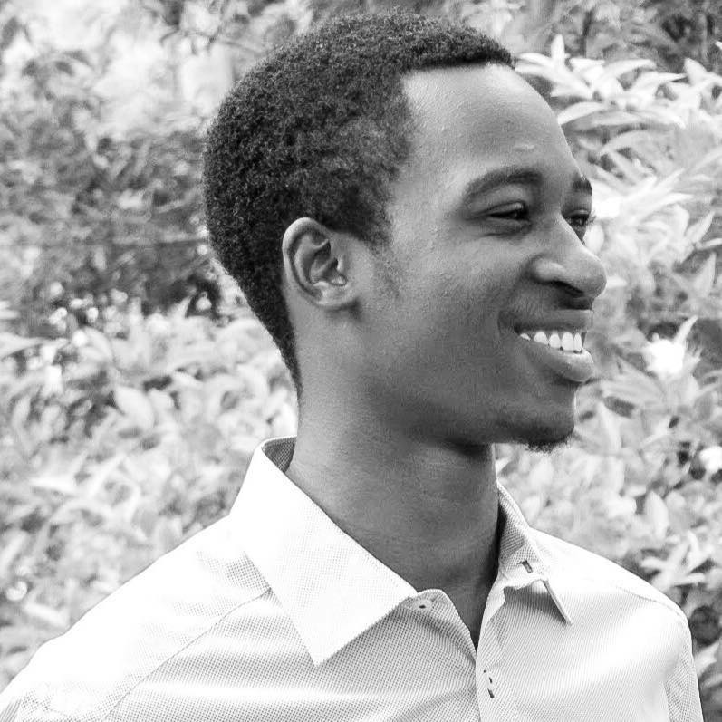

{::nomarkdown}

  <h1>Press Kit</h1>
  
Bios, photos, speaking topics, and contact details for journalists, podcasters, and event organisers.

{:/nomarkdown}

## Short bios

### One-liner
Brisbane-based founder and technologist building software and community programs for African-Australian and refugee communities.

### 50 words
Bakari Mustafa is a Brisbane-based founder and technologist. Born in Burundi and raised in Malawi, he moved to Australia in 2015. He founded Mavuno, Mentors Outreach, and Dzaleka Online, serves on the leadership team at Networking African-Australians, and advises Ipswich City Council's Multicultural Advisory Committee.

### 100 words
Bakari Mustafa is a Brisbane-based founder and technologist. Born in Burundi and raised in a UNHCR refugee camp in Malawi, he moved to Australia in 2015 after being granted asylum. He founded Mavuno, an ad-free social network for African Australians, and Mentors Outreach, mentoring program management software used by community groups and organisations. He also built Dzaleka Online, Visit Dzaleka, and DzalekaPay to support residents of Dzaleka Refugee Camp. In Australia, he serves on the leadership team at Networking African-Australians and as an external advisor to Ipswich City Council's Multicultural Advisory Committee.

## Photos

{::nomarkdown}

  <figure class="press-photo">
    
    <figcaption>Primary headshot · <a href="/uploads/bakari_mustafa.jpg" download>Download JPG</a></figcaption>
  </figure>
  <figure class="press-photo">
    
    <figcaption>Portrait photo · <a href="/uploads/1_v-uxvos8ck61inhhsoq6rw.jpeg" download>Download JPG</a></figcaption>
  </figure>

{:/nomarkdown}

Photos may be used for editorial coverage, event programs, and podcast artwork with credit to Bakari Mustafa.

## Speaking topics

- Building practical software for refugee and diaspora communities
- From Dzaleka Refugee Camp to starting community organisations and software in Australia
- Running youth homework clubs, mentoring programs, and leadership camps at scale
- Local-first and privacy-respecting software design

## Press & mentions

{::nomarkdown}
<ul class="ledger-list">
  <li class="ledger-row">
    Sep 2026
    
      Ipswich City Council
      <a href="https://www.ipswich.qld.gov.au/News-Articles-Folder/2026/External-advisors-to-strengthen-work-of-Multicultural-Advisory-Committee" target="_blank" rel="noopener noreferrer">External advisors to strengthen work of Multicultural Advisory Committee</a>
    
  </li>
</ul>
{:/nomarkdown}

## Media contact

{::nomarkdown}
<ul class="ledger-list">
  <li class="ledger-row">
    Press
    <a href="mailto:media@bakarimustafa.com">media@bakarimustafa.com</a>
  </li>
  <li class="ledger-row">
    General
    <a href="mailto:bakari@bakarimustafa.com">bakari@bakarimustafa.com</a>
  </li>
  <li class="ledger-row">
    Speaking
    <a href="/contact/">Contact form</a>
  </li>
  <li class="ledger-row">
    Mail
    Parcel Collect 10191 10633, Shop 3, 69 Ann Street, Brisbane QLD 4003, Australia
  </li>
</ul>
{:/nomarkdown}
