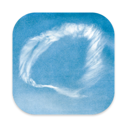
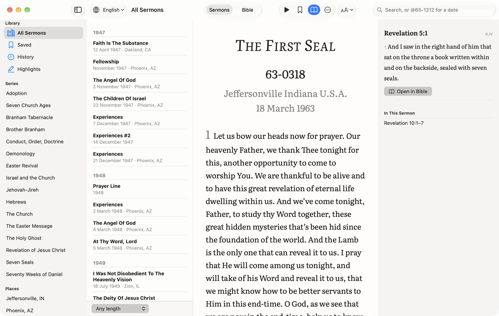
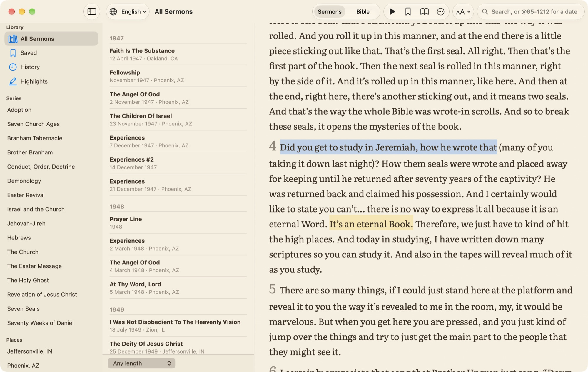
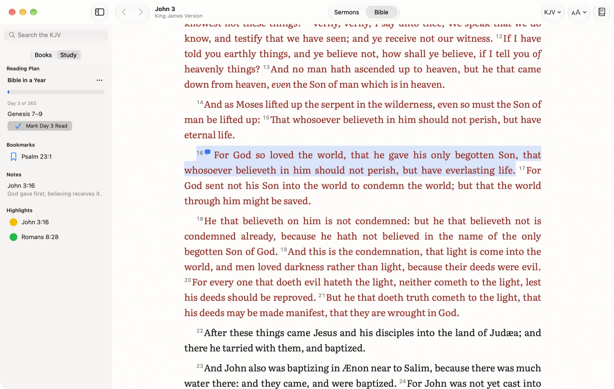
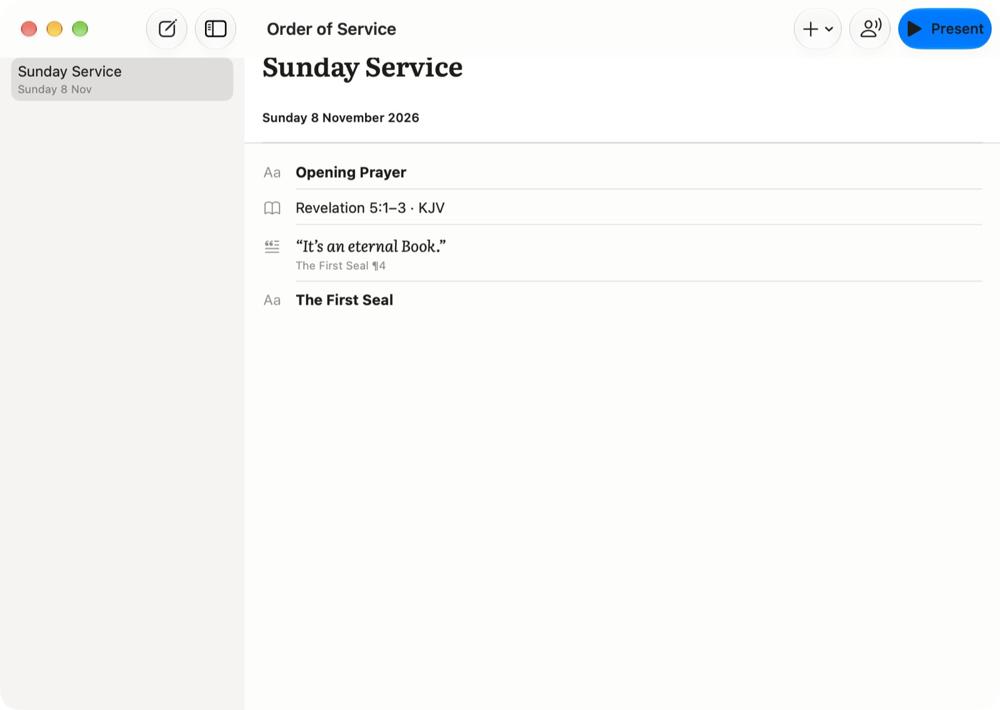
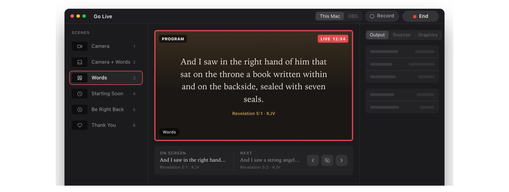
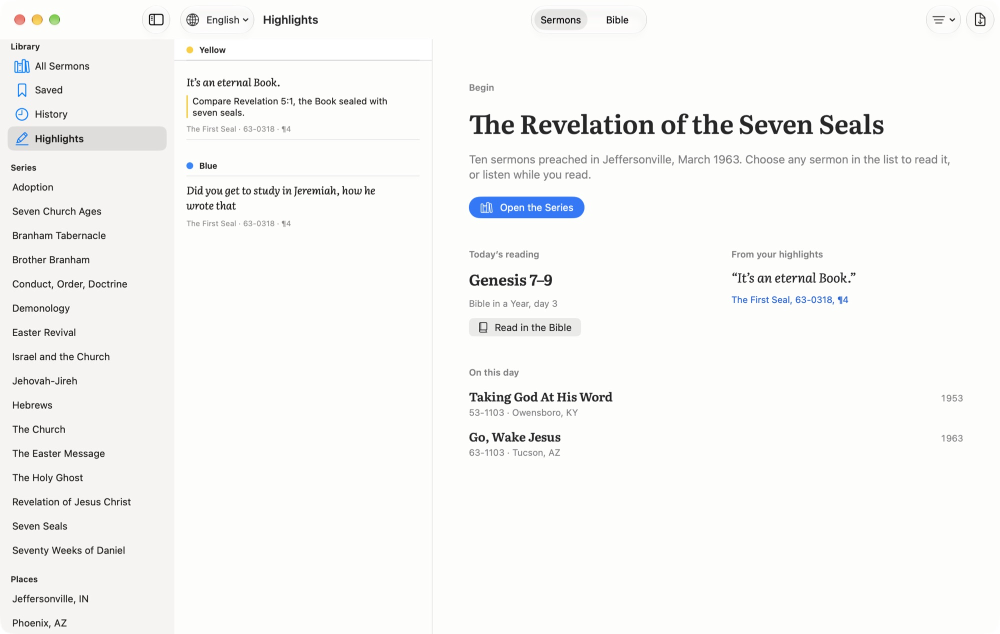
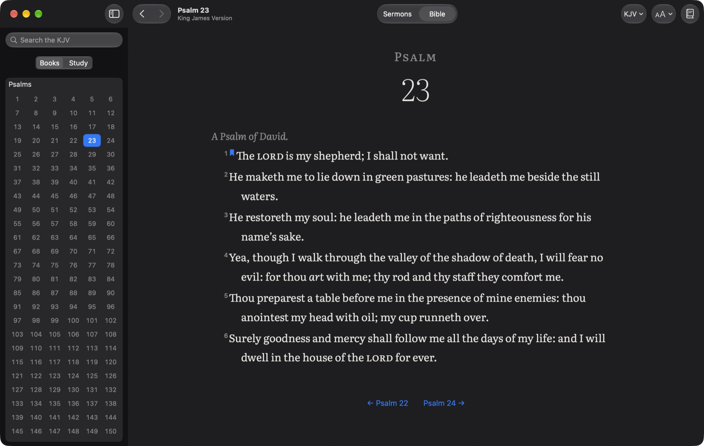

<link rel="preconnect" href="https://fonts.gstatic.com" crossorigin>
<link rel="stylesheet" href="/assets/js/the-message/stages.css">

<link href="https://fonts.googleapis.com/css2?family=Literata:ital,opsz,wght@0,7..72,400;0,7..72,600;1,7..72,400&display=swap" rel="stylesheet">

  
  
For Mac

  <h1>The Message</h1>
  
William Branham’s sermons and the Bible, side by side. Read them, hear them, study them, and put the words on the screen on Sunday.

  

    <a class="tm-button is-primary" href="https://github.com/realbakari/the-message-mac/releases/latest/download/The-Message.zip">Download for Mac</a>
    <a class="tm-button" href="/the-message/">Browse the sermons on the web</a>
  

  
Version 1.2 · Requires macOS 26 · <a href="https://github.com/realbakari/the-message-mac/releases">Release notes</a>

  

<section class="tm-row">
  

    <h2>Sermons set like the printed books</h2>
    
More than 1,200 sermons, with transcripts in over 70 languages. Each one opens with its title, date code and place, then numbered paragraphs in a book face, so a page reads like the printed transcript.

    <ul class="tm-points">
      <li>A sermon reopens at the paragraph you reached. ⌘J goes to any paragraph.</li>
      <li>Listen from where you stopped, at 0.75× to 2×, with a sleep timer and the Mac’s media keys.</li>
      <li>Highlight words in six colours, add a note, and copy a quote with its source.</li>
      <li>Save a sermon to read it without a connection.</li>
    </ul>
  

  

    
  

</section>

<section class="tm-row is-flipped">
  

    <h2>The Bible, open beside them</h2>
    
Seven public-domain translations come with the app, the KJV among them, and the NET, NLT and ESV load from their publishers. A reading in a sermon, such as Revelation 10:1–7, is a link, and a chapter lists the sermons that read from it.

    <ul class="tm-points">
      <li>⌘K goes to a passage the way you’d write it: jn 3:16, rom 8, jude 3.</li>
      <li>Search every word, an exact phrase, one testament or one book.</li>
      <li>Cross references for any verse, compare translations, or read two side by side.</li>
      <li>Highlights, notes, bookmarks and reading plans, kept on your Mac.</li>
    </ul>
  

  

    
  

</section>

<section class="tm-sunday">
  

    <h2>Ready for Sunday</h2>
    
Plan the service, then present it. Passages, quotes from the sermons and headings go in order, and the projector steps through them a verse or a paragraph at a time.

  

  

    
  

  

    

      <h3>Add from anywhere</h3>
      
Right-click verses, sermon words or a highlight and choose Add to Service.

    

    

      <h3>Speaker View</h3>
      
What the room sees, what comes next, the time, and a countdown that turns orange near the end.

    

    

      <h3>On the livestream</h3>
      
A lower third over green or transparency, for OBS and other streaming software.

    

  

</section>

<section class="tm-sunday">
  

    <h2>Go live from the same Mac</h2>
    
Stream the service to YouTube or Vimeo with the verse on screen. Count down to the start, go live, and cut to the words you present, in your church’s own look.

  

  

    
  

  

    

      <h3>Your church’s look</h3>
      
Your logo, typeface and colours, from six presets. The stream, the lower third and the projector all follow it.

    

    

      <h3>Works with OBS</h3>
      
Switch OBS’s scenes, start its stream and recording, and send it the verse, from the same window.

    

    

      <h3>Record the service</h3>
      
Keep what goes out, then trim it and take out the long silences in the Recording Studio.

    

  

</section>

<section class="tm-row">
  

    <h2>Your highlights, by subject</h2>
    
Name the six colours for what you study, such as Faith or The Seals. Every highlight from every sermon is filed under its colour with its note, and the whole list exports as a PDF.

  

  

    
  

</section>

<section class="tm-row is-flipped">
  

    <h2>Light, sepia or dark</h2>
    
Pick the paper and the whole window follows: sidebars, lists and sheets. Text size, red letters and one verse per line are a keystroke away.

  

  

    
  

</section>

  
<h3>Search like The Table</h3>
@65 for a year, @65-1212 for a day, @64-0401 59 to open paragraph 59.

  
<h3>On this day</h3>
Home shows the sermons preached on today’s date.

  
<h3>History</h3>
What you’ve read and what you’ve listened to, and Home shows how far you got.

  
<h3>Every language</h3>
Open a sermon in any of the languages it was translated into.

  
<h3>Your study, portable</h3>
Export highlights, notes and bookmarks as Markdown or JSON, and import them back.

  
<h3>Keyboard first</h3>
⌘K, ⌘J, J and K between verses, 1 to 6 to highlight. ⌘/ lists them all.

  <section class="tm-panel">
    <h2>Private by design</h2>
    
No account, no analytics and no advertising. Your highlights, notes, history and plans stay on your Mac. The app asks the internet only for sermons, recordings and the Bible text it doesn’t carry.

  </section>
  <section class="tm-panel">
    <h2>Also on iPhone</h2>
    
<strong>The Message: Sermons &amp; Bible</strong> brings the sermons, read-along and the Bible to iPhone.

    
<a href="/the-message/support/">Support</a> · <a href="/the-message/privacy/">Privacy policy</a>

  </section>

Sermons and recordings come from <a href="/api-docs/">The Message API</a>. The bundled Bibles are public domain, from eBible.org. Cross references are from <a href="https://www.openbible.info/labs/cross-references/">OpenBible.info</a> (CC BY 4.0). Text is set in Literata (SIL Open Font License). The NET, NLT and ESV are used under their publishers’ terms, with their notices in the app.

